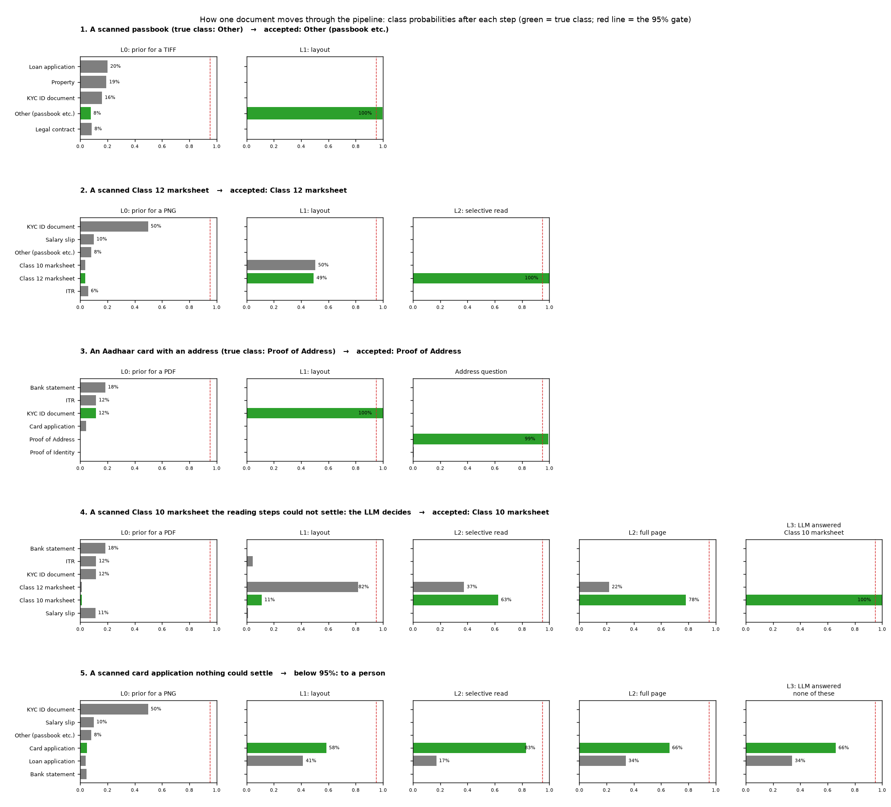

# Classifying 5M bank documents on a fixed budget

A prototype for the IDfy Privy APM take-home. The task: sort 5 million mixed-format documents from an S3 bucket into 15 classes for at most Rs 1,00,000, with macro-F1 at least 0.85 and recall at least 0.90 on the critical classes.

**Deliverables** (`deliverables/`):
- `approach.pdf`: the two-page approach note, including the local intelligence used.
- `flowchart.drawio`: the pipeline, with the accept-vs-spend-more rule at every gate (open at app.diagrams.net).
- `notebooks/walkthrough.ipynb`: runs the training and evaluation and shows every number below; already run, so the outputs are visible without running it. To run it in the browser with nothing to install: [](https://colab.research.google.com/github/vansh-gandhi-02/privy-doc-classifier/blob/main/notebooks/walkthrough.ipynb) (Runtime, Run all; about 30 minutes on Colab's free CPU).

## The idea

Every document carries a probability for each class. It starts from the class mix expected for its file format, never zero. Each level reads more of the document, at a higher price, and updates the probabilities with Bayes' rule. A document stops as soon as one class reaches 95%; otherwise it buys the cheapest next evidence that can still separate the classes in play. Money is spent only where the evidence so far cannot decide, so 99.5% of documents never reach the LLM.

```
file ─▶ L0 open ─┬─ duplicate? ─▶ copy the first copy's label
                 ├─ trusted text ─▶ L2 text model ─▶ (L1 if still unsure)
                 └─ scan / image ─▶ bundle splitter ─▶ L1 layout ─▶ L2 reading ladder
                                                               │
          KYC ID document? ─▶ address question (PoI or PoA) ◀──┤
                                                               ▼
                                       still below the gate ─▶ L3 LLM ─▶ L4 human
```

**One document at a time** (`deliverables/how_a_document_moves.png`, from `scripts/trace_document.py`): five real dev-test documents and their class probabilities after every step. A passbook is settled by layout alone; a Class 12 marksheet needs a few lines of text; an Aadhaar card goes through the address question; a Class 10 marksheet that layout gets wrong is pulled back by reading and settled by the LLM; a card application nothing can settle goes to a person.



| Level | What it reads | Cost (one laptop core) | Folder |
|---|---|---|---|
| L0 Open | Bytes, trusted visible text, checksum | 2.5 ms per file | `pipeline/l0_open/` |
| L1 Layout | A picture of the page: frozen DiT + 6 readable signals; the bundle splitter | 0.11 s per page | `pipeline/l1_layout/` |
| L2 Text | Free text, or a reading ladder over OCR (selective read, full page, later pages); the address question for KYC | 0.5 s / 2.2 s per read | `pipeline/l2_text/` |
| L3 LLM | Masked text and 2-5 candidate classes; Claude Haiku | about Rs 0.04 per call | `pipeline/l3_llm/` |
| L4 Human | What is still unsure | no price quoted; counted | `pipeline/l4_human/` |

A budget controller (`pipeline/controller.py`) watches spend against a plan line and moves one gate, between 85% and 99%, at every step before the LLM; critical documents never get a gate below 95%. `pipeline/README.md` and each level's README explain the method and why it was chosen; `DECISIONS.md` records every decision (D1-D30) and its reasoning.

## Results

All documents are synthetic (a generator for 45 document types, 4 layouts each, with scans, photos, emails, merged bundles and duplicates), plus bank statements from an outside generator. No sealed test set (lockbox) was used to train, tune or choose anything; each was run exactly once.

| Test set | Macro-F1 (human review counted as errors) | Critical recall (PoI, PoA, Legal, Property) |
|---|---|---|
| Dev-test, 843 documents | 0.998 | 1.00, 1.00, 1.00, 1.00 |
| Lockbox A: 805 files, 40% in a layout never seen in training | 0.990 | 1.00, 0.98, 0.95, 1.00 |
| Lockbox C: 394 fresh files, built after everything was frozen | 0.982 | 1.00, 1.00, 1.00, 1.00 |

Merged PDFs from an outside source (AgamiAI bank statements, Hugging Face):

| Test set | Splitter | Result |
|---|---|---|
| Lockbox B: 120 statements | Layout only | Each 6-page statement cut into about 2.5 pieces; 81% of pieces labelled correctly |
| Lockbox D: 120 fresh statements | With printed page numbers (D30) | All 120 kept whole; 114/120 (95%) labelled correctly; 22 settled by the LLM, 4 sent to a person |

Per-class precision, recall and F1 for every test set: `python -m scripts.report_bar` (and section 5 of the notebook).

## Cost at 5M documents

| Item | Cost |
|---|---|
| L0, and L1 on every page | Rs 2,340 |
| Selective read of every scanned page, page-number lines of multi-page scans | Rs 9,810 |
| Further reads (full pages, later pages, KYC address reads) | Rs 8,280 |
| LLM (about 0.6% of documents) | Rs 1,170 |
| Human review (about 2,600 documents; the brief quotes no price) | Rs 0 |
| **Total** (cloud vCPU taken as 2x slower than the laptop core measured, 3 pages per PDF) | **Rs 21,600** (0.43 paise a document; 95% interval from measurement Rs 20,450 to Rs 22,770, about plus or minus 5.4%) |
| Brute force: OCR every page, send every document to the LLM | Rs 1,30,170 |

The measured inputs give the 95% interval. Two assumptions cannot be measured on a laptop: cloud CPU speed and pages per PDF. The worst combination we can justify (3x slower, 6.2 pages per PDF) is about Rs 43,800, still under our Rs 50k target. Before a real run, L0 over the whole bucket (about Rs 225) gives exact page counts. `python -m costs.precision` prints the full table.

## Run it

```
python3.12 -m venv .venv && source .venv/bin/activate && pip install -r requirements.txt
python -m scripts.run_all              # everything, from the cached results in artifacts/ (~15 min on a laptop)
python -m scripts.run_all --full       # rebuild from scratch: generate documents, render, OCR (~2 h on 6 cores)
python -m scripts.classify <folder>    # classify any folder of your own documents, end to end
pytest -q                              # 33 tests
```

**About the LLM step.** The LLM answers in this repo were made with `claude -p` on a Claude subscription, priced at the brief's token rates, and are replayed from `artifacts/`. To run the LLM step on your own documents you need the `claude` CLI logged in to your own subscription, or to swap `pipeline/l3_llm/llm.py`'s `call()` for an API client with your own key. Without either, `scripts/classify.py --no-llm` still runs every other level and marks those documents `NEEDS_LLM`.

## Repo map

```
pipeline/       the classifier: posterior.py, run.py, controller.py, and one folder per level (l0_open ... l4_human)
config/         the brief's facts, the 15 classes, our assumptions (class mix, budget)
docgen/         the synthetic document generator
scripts/        build, train, evaluate, run_all, classify
costs/          unit-cost timing, the 5M cost model with its precision, the brute-force baseline
evaluation/     macro-F1 and critical recall
tools/          builds the flowchart and the approach note from the results; packs the cache
notebooks/      walkthrough.ipynb
artifacts/      cached OCR text, page features, LLM answers, timings and lockbox results
tests/          33 tests
DECISIONS.md    every decision and why
```
